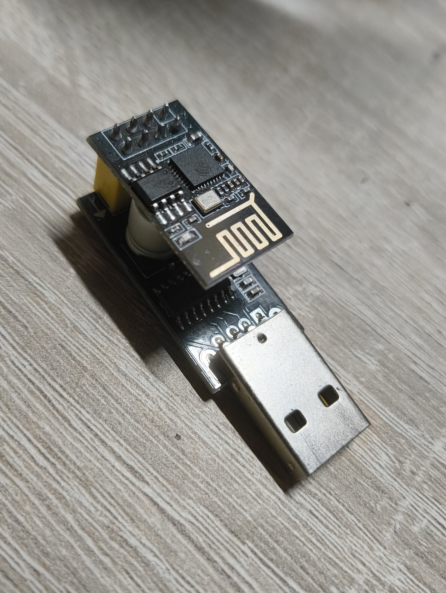
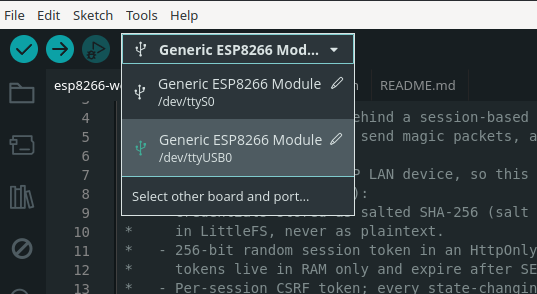
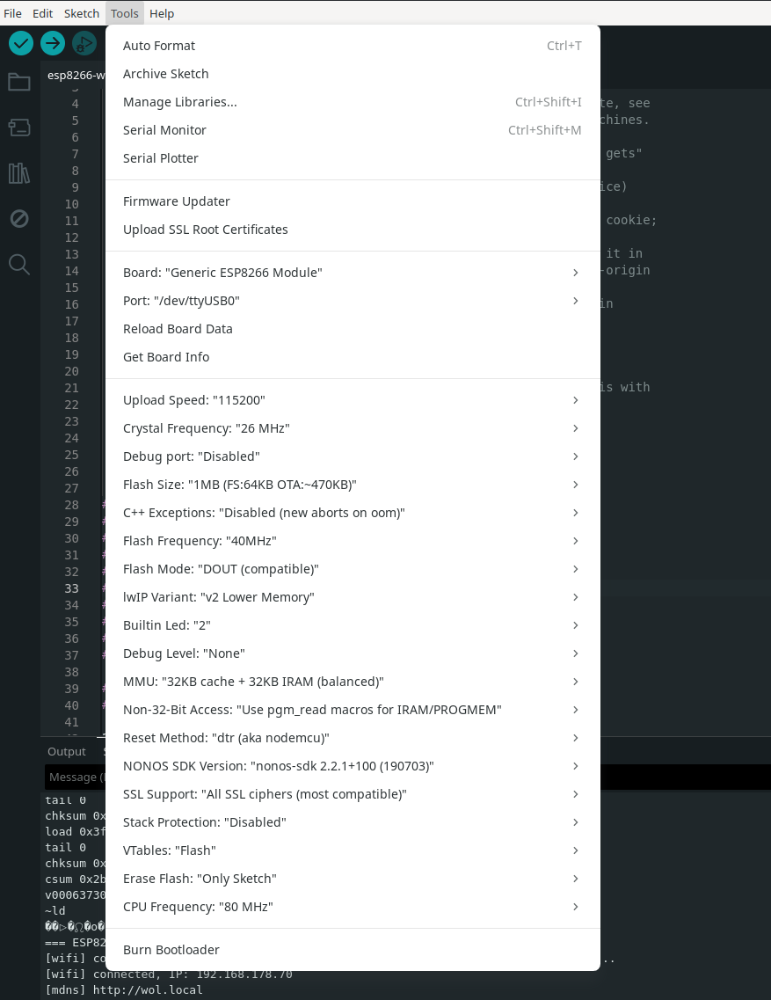
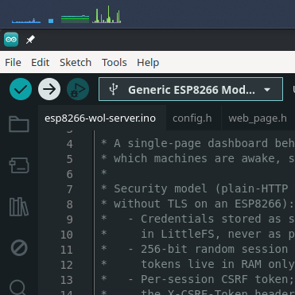
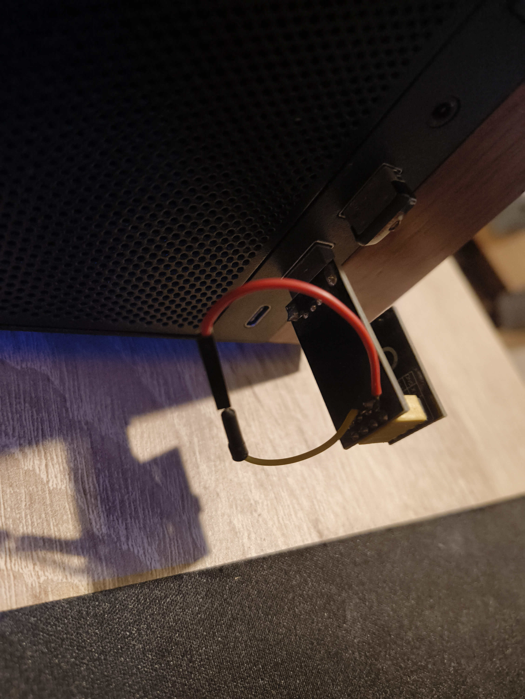
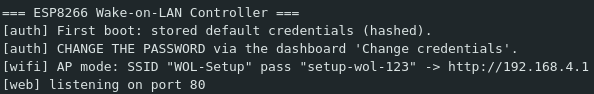
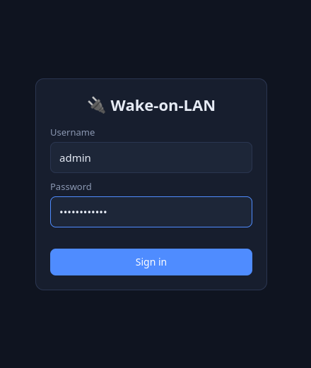
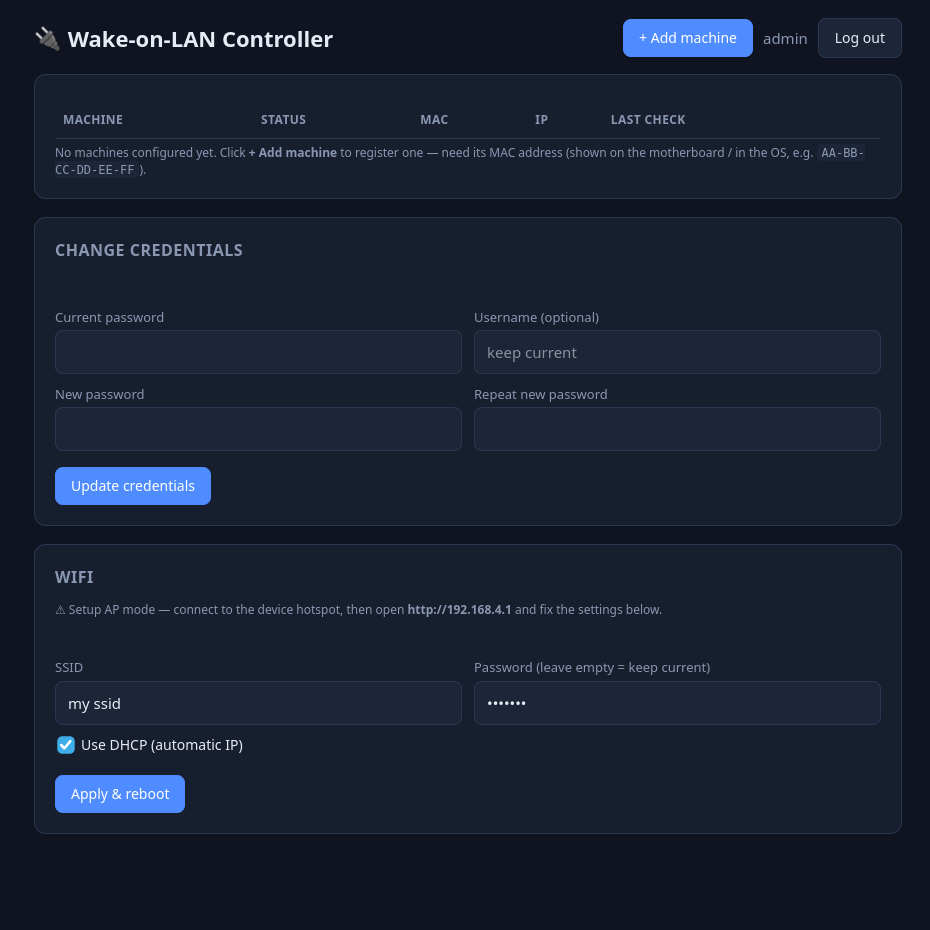
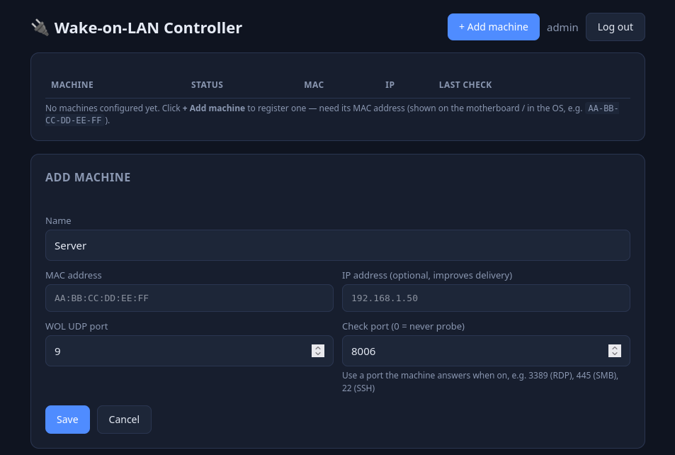
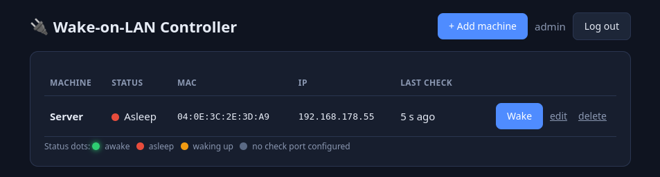

# esp8266-wol-server

"Work in progress not secure for now"

A Esp8266 Server that Serves a Website, from which you can start a PC via Wake on Lan. It also includes a hotspot for configuration when the wifi is not available. Useful if you want to start a server/pc from a remote location and you can't send a WOL packet (Fritzbox Wireguard).
# Prerequisites

- A PC that is configured for Wake On Lan
- ESP8266 (I use an ESP8266-01 because of the size, but others work completely fine too)
  

- Arduino IDE or another flashing utility
- ESP 8266 Board Packets (Arduino  "http://arduino.esp8266.com/stable/package_esp8266com_index.json"))

# Installation

1. Download the config.h, esp8266-wol-server.ino and web_page.h or clone the repo and open it in your flashing-tool of choice. (If you want to hard code a wifi ssid and password you can do this now in the config.h or configure it later via the fallback hotspot.)

2. Select the correct port and board and configuration for your board 

  

  Example:

3. Upload the code and check for errors. If library are missing install them. Don't forget to bridge the GPIO0 to GND to upload the code if your board requires it.

4. Once flashed unplug the board and unbridge the GPIO0 and GND

5. (If you have hard coded the wifi connection and the connection is available skip to step 8)
Plug it back in with the opened serial monitor at 115200 baud here you can see the IP SSID and password.

6. When connected go to http://192.168.4.1/ here you will see the fallback login menu connect with the default credentials user: admin and password :changeme-123

7. Here you can change add your wifi and change your credentials. If you want you can even add your first machine to start remotely.

8. Now get the IP address of the Esp from your router and connect to it via http. and login with your credentials (default user: admin and password :changeme-123)

9. Now you are greeted with the same Dashboard as in the setup and you can make changes to the Password or Wifi. After you have configured this to your liking add a new machine to wake up. Just click on "add machine".
Now just name your PC and add the MAC and click Save. If you want you can add the IP address to check if the server is running also add a port that you know the machine answers,

 Now you can check and wake up you Machine remotely!

This Project was created with AI Assistance (Mistral Vibe)
